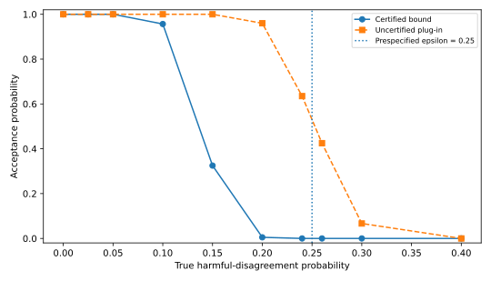
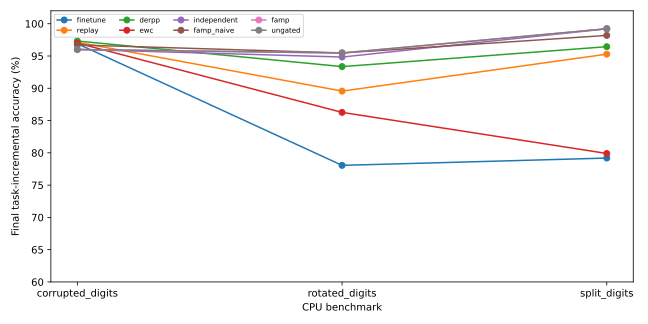

# FAMP: When Can a Continual Learner Trust a Frozen Memory?
## Evidence-Gated Publication, Independent Audit, and the Limits of Functional Reuse

*ACM TRUST 2027 research manuscript draft — revised October 30, 2026. This is a source-grounded, CPU-scale experimental study, not a peer-reviewed or venue-formatted submission. All numerical results reported below come from the checked-in experiment summaries. Illustrative examples are explicitly marked.*

### Abstract

Imagine a neural network that has just learned to distinguish handwritten zeros from ones. It will next be trained to distinguish twos from threes, and later other pairs of digits. Unfortunately, changing the network to learn a new task can make it worse at tasks it previously solved. One established remedy is to save examples of earlier tasks and show them to the network again during later training. Another possibility is to preserve a smaller network that can already solve an earlier task. This could eventually reduce the need to store old examples, especially if the same learned components can help with several tasks.

But a smaller network is not necessarily a reliable substitute. Suppose the original network and the smaller network both classify 95% of handwritten zeros and ones correctly. They might nevertheless make mistakes on different images. Replacing the original solution could therefore lose abilities the system previously had, even though average accuracy appears unchanged.

We investigate this replacement decision through FAMP. For each new task, a shared neural network first learns to solve it; we call this the **current network**. FAMP then considers compact networks that might preserve that task's solution. It chooses a proposed replacement using one group of examples, and tests that replacement using a separate group that was not used to choose it. The test asks how often the compact network makes mistakes on images the current network classified correctly. Because only finitely many images are available, FAMP also estimates how uncertain that observed mistake rate is. Additional checks require the current network to meet a minimum measured accuracy and the two networks to give reasonably similar prediction probabilities. If the checks pass, the compact network is stored and protected from changes during later training. If they fail, the task continues using the current network, with saved examples available for subsequent learning. These checks provide limited evidence about a replacement; they do not establish that either network is universally correct.

We evaluate both the reliability of this decision procedure and the usefulness of the complete learner. In 6,000 controlled trials where the underlying mistake rates are known, the statistical estimates were conservative; none of the 1,800 tested proposals whose true damaging-mistake rate exceeded the allowed limit was accepted. We also evaluated nine continual-learning methods in 162 CPU runs using five-task streams derived from the small scikit-learn handwritten Digits dataset. FAMP obtained mean final accuracies of **99.22%** for digit-pair tasks, **95.47%** for rotated digits, and **96.00%** for noisy digits. It outperformed ordinary example replay on the first two settings, but did not outperform a version that stored compact networks without the additional acceptance checks. It also showed **no sharing of stored network components between tasks**, required more retained memory than replay, and was less accurate than replay-based methods on noisy digits. Thus, while the experiments demonstrate an inspectable process for deciding what to preserve, they do not demonstrate the originally hoped-for memory savings through reusable computations. Reliable checking, successful learning, and efficient reuse must be evaluated separately.

---

## 1. Introduction: the problem before the method

### 1.1 A model that must learn tomorrow without forgetting yesterday

Consider a handwriting system that receives tasks one at a time. Today it learns to distinguish the digit **0 from 1**. Tomorrow it learns **2 from 3**. Later it learns **4 from 5**, **6 from 7**, and **8 from 9**. At the end, we want it to perform all five tasks.

A single neural network updated successively on each new task can overwrite behavior learned earlier, a phenomenon commonly called **catastrophic forgetting**. One familiar response is **experience replay**: retain a small number of examples from earlier tasks and mix them into later training. This helps, but the system must choose which examples to retain, and replay memory is finite.

Another response is to save the computation for an old task. For example, after learning 0 versus 1, the system could store a small neural encoder and its classifier and promise not to change them. When asked about that task again, it executes the frozen computation. This can protect the old prediction rule from later training updates, but saving one separate model per task can be expensive. A natural next idea is **reuse**: perhaps an encoder learned for 0 versus 1 also extracts features useful for 2 versus 3. Then a new head could reuse an existing encoder rather than storing another entire encoder.

Reuse is appealing, but it can fail silently. Two networks may produce similar features yet make different mistakes. A small feature extractor may work well on average while failing on a subset of inputs the original system handled correctly. If ordinary training examples are deleted after accepting this replacement, the mistake may be hard to reverse.

This is the motivation for our study. We are not asking only **“Can a network remember?”** We ask:

> **What evidence should a continual learner require before replacing the way it remembers a task?**

### 1.2 A concrete example of a risky replacement

Suppose the current network can distinguish 0 from 1, and we have trained a compact candidate that appears to perform the same job. On a held-out batch, the current network makes 140 correct predictions out of 150, while the candidate makes 141 correct predictions. It is tempting to accept the candidate because its overall accuracy is slightly higher.

But overall accuracy does not tell the entire story. The candidate might fix three mistakes made by the original network while introducing two **new** mistakes on examples the original network classified correctly. The two additional mistakes are important if the purpose of the replacement is to preserve an existing capability. We call this type of mistake **harmful disagreement**.

An assurance-oriented publication rule should examine this asymmetry, not just compare two accuracy percentages. It should also acknowledge sampling uncertainty: observing two harmful cases in 150 images does not mean the true harmful-error probability is exactly 2/150.

### 1.3 Three different questions must not be conflated

This paper distinguishes three objectives that are often discussed together:

1. **Preservation:** once a task's function is stored, do later task updates change that exact function?
2. **Assurance:** before storing a replacement, can we establish a statistically meaningful, limited statement about its risk relative to a reference model?
3. **Reuse efficiency:** can one stored encoder actually serve several tasks, saving enough state to justify its selection and auditing overhead?

A frozen function gives a straightforward form of *structural preservation*. A statistical admission test can provide *conditional assurance*. Neither property by itself establishes *reuse efficiency*. Our experiments show why this separation matters.

### 1.4 Contributions and findings

We make four bounded contributions. First, we present a readable publication protocol that separates candidate construction, selection, independent acceptance, immutable routing, and retained-state accounting. Second, we give its statistical meaning and assumptions precisely: the confidence bound is **teacher-relative**, not a certificate of absolute correctness. Third, we study the gate under known population risk, so both false admission and unnecessary rejection can be measured. Fourth, we compare the complete learner with replay, EWC- and DER++-style baselines, independent units, and gate ablations using a small, fully CPU-executable task suite.

The central empirical findings are mixed. FAMP's frozen paths can retain high task-incremental accuracy on two streams, and its risk certificate behaves conservatively in synthetic calibration. However, the strict implementation does not produce physical encoder sharing in the observed benchmark runs and does not beat an ungated modular learner. The dominant source of accuracy improvement appears to be **task isolation**, not a measured benefit of statistical certification.

---

## 2. One example from beginning to end

Before describing the formal test, we follow a single digit-classification task from its arrival to the decision about what to remember. This section is meant to answer the practical questions: **What is trained? What is saved? What is compared? And what happens if the comparison fails?** No statistical background is needed to follow the sequence.

This section is a guided illustration, not a recorded experimental trace. Its numbers are chosen to make the procedure concrete. Actual aggregated experiments are reported in Section 6.

### 2.1 What the learner sees

We use five binary classification tasks created from handwritten images. For the first task, the learner receives pictures of 0s and 1s and must predict a local label: 0 or 1. When the next task arrives, it receives pictures of 2s and 3s. The learner is told which task is being requested at test time; we do **not** ask it to infer the task identity or classify all ten digits with a single ten-way output.

For each digit and each random data split, the implementation allocates:

| Partition | Examples per original digit | What it is allowed to influence |
|---|---:|---|
| Training | 55 | Update network parameters and fit candidate heads |
| Selection | 20 | Choose **one** candidate route before certification |
| Acceptance | 75 | Certify or reject the selected route |
| Test | Remaining examples | Evaluate reported performance; never train or select |

Therefore a digit-pair task has **150 acceptance images**, with 75 examples of each local class. Different splits have different jobs. In particular, the acceptance set must not quietly become another training or tuning set.

### 2.2 The three pieces of state

The running learner has:

- **Fallback network:** a shared, mutable neural network trained on new tasks and stored replay examples. It produces a prediction for a supplied task ID.
- **Unit bank:** compact, potentially reusable feature extractors that have been frozen after publication.
- **Routes:** small task-specific classifiers (heads) that take features from a unit and produce the task's answer. A route records which physical unit it uses.

The system starts with no published units. On Task 1, it trains the fallback and proposes a compact candidate. On Task 2, it can either train another unit or attempt to attach a new head to the existing Task 1 unit. This second option is **reuse**. Reuse would be measured by observing the **same unit identifier** referenced by more than one published task route.

### 2.3 From candidate to accepted memory

The learner first trains candidate functions on training data. It then evaluates them on the selection split and chooses a single candidate. This is important: the later acceptance data are reserved to evaluate a candidate **already chosen**, not to search over several candidates until one happens to pass.

Here is an illustrative certificate for Task 1:

| Quantity | Illustrative value | Why it matters |
|---|---:|---|
| Teacher accuracy on acceptance data | 140/150 = 93.3% | The reference model must be competent |
| Candidate accuracy on acceptance data | 141/150 = 94.0% | Descriptive, not sufficient for acceptance |
| Harmful disagreements in class 0 | 1 of 75 | Teacher correct, candidate wrong |
| Harmful disagreements in class 1 | 1 of 75 | Teacher correct, candidate wrong |
| Raw harmful-disagreement rate | 2/150 = 1.33% | A sample statistic, **not** the certificate |
| Conservative class-weighted upper bound | Approximately **9.49%** | One-sided Clopper–Pearson rule with task/class adjustment |
| Allowed harmful-disagreement tolerance | **15%** | Predeclared publication limit |
| Probability-response RMSE | Hypothetical 0.08 | Additional agreement heuristic; limit is 0.20 |
| Decision | **Accept** | All three publication checks pass |

The 9.49% upper limit is intentionally much larger than the observed 1.33%. The difference represents finite-sample uncertainty and correction for testing across five tasks and two classes.

Now imagine four harmful disagreements in **each** class instead of one. Under the same 75-per-class sample size and confidence allocation, the average upper limit becomes approximately **15.85%**. Even if the candidate's overall accuracy looked acceptable, the harm test would **reject** it because 15.85% exceeds 15%. The system would keep the fallback route for that task.

These examples illustrate what the mechanism *would* do; they are not claimed to be individual measured benchmark episodes.

### 2.4 What happens after acceptance?

If accepted, the candidate encoder and head become a frozen route for Task 1. On later tasks, the mutable fallback network can keep changing; asking for Task 1 invokes its stored route rather than the new fallback state. The candidate's published function is therefore shielded from subsequent gradient updates.

If a proposal is rejected, the system does **not** pretend that the task has a certified new memory. It continues to use the mutable fallback and retains replay examples for that unresolved task.

There is a limitation on both branches. A frozen route could have been wrong at publication, and a fallback model can forget. “Published” means the gate's *specified conditions* passed; it does not mean the route is globally correct. “Rejected” avoids one questionable replacement; it does not mean the fallback is safe.

### 2.5 Workflow at a glance

The following diagram follows the same sequence as the handwriting example. Each box corresponds to a real operational decision. A **route** is simply the saved instruction telling the system which small network to use for a particular task.

The following figure is a conceptual diagram of the implemented CPU procedure.

~~~mermaid
flowchart TD
 A["New task and its training partition"] --> B["Train mutable fallback + existing replay"]
 B --> C["Propose: new compact encoder or old encoder + new head"]
 C --> D["Evaluate proposals on SELECTION split"]
 D --> E["Choose ONE proposal"]
 E --> F["Evaluate chosen proposal on ACCEPTANCE split"]
 F --> G{"Competent teacher AND bounded harm AND response agreement?"}
 G -->|Yes| H["Publish frozen encoder/head route"]
 G -->|No| I["Keep fallback route + replay for unresolved task"]
 H --> J["Count published units, heads, replay and metadata"]
 I --> J
 J --> K["Evaluate on TEST split; record results only"]
~~~

**Figure 1.** The selection set chooses; the acceptance set certifies; the test set measures. None of these roles should be interchanged. The implementation's raw results measure actual publications and the number of physically shared encoders, rather than inferring sharing from feature similarity.

---

## 3. Formal problem and trust contract

The preceding example explains the decision in ordinary language. We now translate that decision into mathematical terms so that a reader can inspect exactly what the proposed guarantee says. Readers interested mainly in the experiment can proceed to Section 5; the central idea is that we bound **new mistakes introduced by a replacement**, not all possible mistakes.

### 3.1 Sequential tasks and known task identity

Let tasks arrive as a sequence of distributions \(\mathcal{D}_1,\ldots,\mathcal{D}_T\). A task provides labeled examples \((x,y)\), and a model is evaluated after learning subsequent tasks. We use **task-incremental classification**: the task identifier \(t\) is supplied at inference. This is materially easier than task-agnostic class-incremental learning, and we do not conflate the two.

For a fixed task \(t\), write \(f_t(x)\) for the current shared fallback teacher and \(g_t(x)\) for a proposed executable route. Their classification risks under a specified distribution \(\mathcal{D}_t\) are

\[
R_t(f_t) = \Pr_{\mathcal{D}_t}[f_t(X)\neq Y], \qquad
R_t(g_t) = \Pr_{\mathcal{D}_t}[g_t(X)\neq Y].
\]

We ask whether replacing the fallback route by \(g_t\) incurs too much **additional error on cases the fallback currently gets right**.

### 3.2 Why comparing average accuracy is insufficient

Define two events:

\[
H_t = \mathbf{1}\{f_t(X)=Y,\ g_t(X)\neq Y\}
\]
\[
G_t = \mathbf{1}\{g_t(X)=Y,\ f_t(X)\neq Y\}.
\]

\(H_t\) denotes harmful disagreement; \(G_t\) denotes a candidate correcting a teacher mistake. Partitioning disagreements gives the exact relation

\[
R_t(g_t)-R_t(f_t)=\Pr(H_t=1)-\Pr(G_t=1)
                  \leq \Pr(H_t=1).
\tag{1}
\]

Equation (1) explains the design choice. If we can conservatively bound harmful disagreement, we also bound the candidate's possible *increase* in error relative to its teacher. The inequality is deliberately one-sided: it does not credit improvements in \(G_t\).

It does **not** say that the candidate's absolute risk is small. A teacher with 50% error can be matched perfectly and still be a poor classifier. A separate teacher-competence guard is intended to address this issue pragmatically, but it is an empirical threshold, not a mathematical guarantee of useful absolute performance.

### 3.3 What “confidence” means here

For class \(c\), let \(n_{t,c}\) be the number of independent acceptance observations from that class and \(k_{t,c}\) the number of harmful disagreements among them. The implemented one-sided exact binomial upper bound is

\[
U_{t,c} =
\begin{cases}
1, & k_{t,c}=n_{t,c},\\
\operatorname{Beta}^{-1}\!\left(1-\frac{\alpha}{TC};
                     k_{t,c}+1,\ n_{t,c}-k_{t,c}\right),
& k_{t,c}<n_{t,c}.
\end{cases}
\tag{2}
\]

Here \(\operatorname{Beta}^{-1}\) is a beta-distribution quantile, \(\alpha\) is the familywise nominal failure level, \(T\) is the predeclared number of tasks, and \(C\) is the number of classes. In our binary five-task neural setting, \(\alpha=.05\), \(T=5\), and \(C=2\), so the per-class tail allocation is \(0.05/(5\cdot2)=0.005\).

For known, balanced class weights, the implementation aggregates the classwise limits as

\[
U_t = \frac{1}{C}\sum_{c=1}^{C} U_{t,c}.
\tag{3}
\]

The general version would use explicitly known class priors \(w_c\) and \(U_t=\sum_c w_c U_{t,c}\). A missing class contributes upper bound 1, rather than falsely certifying zero harm.

Under independent within-class draws, the fixed-proposal/held-out sampling contract, the stated class weights, and the per-task validity conditions, the classwise Clopper–Pearson bounds plus a union bound yield the corresponding simultaneous coverage statement. It is a **statistical guarantee conditional on a data-generation protocol**, not a formal proof of a neural network's behavior on all possible inputs.

### 3.4 The complete admission decision

For the neural benchmark, a proposed route is published when all of the following are true:

| Criterion | CPU experimental rule | Status |
|---|---|---|
| Reference competence | Measured teacher accuracy on acceptance data ≥ 0.70 | Heuristic guard |
| Harmful disagreement | \(U_t \leq 0.15\) | Statistical harm gate under assumptions |
| Response agreement | RMSE between teacher and candidate softmax probabilities ≤ 0.20 | Heuristic guard |

The response agreement is calculated from predicted **class probabilities on the acceptance images**. It is **not** a perturbation robustness certificate, causal intervention test, or guarantee under shifted data. It also is not required by Equation (1); an ablation can reveal whether it improves practical routing.

After these conditions pass, the unit and head are published. The described CPU implementation does **not** enforce a hard byte cap at admission time; it instead records the retained-state proxy after each task. This is a deliberate difference from the earlier, more elaborate FAMP memory-budget proposal and limits the resource claims we can make.

### 3.5 Which assumptions the benchmark satisfies—and which it does not

There are two separate evaluation regimes in this work.

**Controlled calibration** (Section 5.1) draws fresh independent observations for each simulated certificate, with known harmful-disagreement probabilities. This setting is designed to test the statistical calculation.

**Neural continual-learning experiments** (Section 5.2) use fixed partitions from a finite, small image dataset. Training, selection, acceptance, and test image *roles* are separated. However, in the Rotated and Corrupted Digits streams, the **same underlying acceptance image indices are transformed and reused across successive tasks**. Earlier acceptance decisions can affect what the adaptive system publishes, and later proposals can depend on those decisions. Therefore, although no acceptance image is directly used for gradient training or ordinary candidate selection, the neural domain-stream protocol does **not** justify claiming the full sequential familywise statistical guarantee without a more careful dependent-data analysis or fresh taskwise acceptance samples.

We explicitly restrict the reported bound-calibration evidence to the controlled synthetic regime, and interpret real-neural acceptance records as **operational gate decisions** rather than empirically proved familywise coverage statements.

### 3.6 What an audit can and cannot establish

An audit record includes the task identifier, policy, classwise sample counts, observed harmful disagreements, upper bounds, teacher and candidate accuracy, response RMSE, pass/fail checks, and a certificate hash. An independent verifier can recompute the same certificate **when supplied with the original acceptance labels and both prediction vectors**.

The implementation also hashes published evidence files. Rechecking those hashes against a **separately trusted** manifest can detect changes to the files. A self-supplied unsigned hash is not authentication: an attacker who can rewrite both file and manifest can make a matching pair. Further, the compact per-run result summaries do not by themselves contain all per-example prediction vectors needed for complete offline re-verification; this requires reproducing them or retaining those inputs and outputs under a trusted evidence policy. These are important limits of the present audit artifact.

---

## 4. Implemented methods: what changes, and what stays comparable?

To know whether FAMP helps, it is not enough to show that it performs well. We need alternatives that answer different explanations for its success. Perhaps **saving any old examples** is sufficient. Perhaps **freezing a separate network for each task** is sufficient. Perhaps the proposed safety check makes no difference at all. The methods below are chosen to distinguish these explanations.

The project evaluates nine CPU methods. Each uses the same Digits-derived task streams, three configured seeds, and two task orders. We group them conceptually rather than treating nine names as self-explanatory.

### 4.1 Baselines without published task routes

**Sequential fine-tuning** updates a shared neural model on each incoming task, with no retained replay samples. It measures what happens when later tasks directly overwrite earlier weights.

**Experience replay** stores a small, fixed number of examples from tasks that remain on the fallback route, then trains using both new examples and old memory. It is a conventional baseline for reduced forgetting.

**DER++-style logit replay** augments stored examples with earlier output logits and applies an additional output-matching term during later updates. This is a simplified CPU adaptation, not an exact reimplementation or reference-hyperparameter reproduction of DER++.

**Online-EWC-style regularization** estimates a diagonal Fisher-like parameter-importance measure and penalizes movement away from previous parameter values. It is likewise a small in-house adaptation, not an author-verified reproduction of every choice in the original EWC method.

These controls help determine whether allocating separate frozen functions is useful relative to keeping one evolving network. They do not, by themselves, establish whether the **assurance gate** is beneficial.

### 4.2 Functional-memory controls

**Independent units** train a compact new encoder and head for each task. They use a gate but cannot select a previously published encoder. This is the key control for the *reuse* hypothesis: if FAMP has no shared units and performs like independent units, the outcome may be explained by task isolation.

**Ungated functional publication** uses the same candidate search but publishes its selected route without an assurance veto. It is the key control for the *certification* hypothesis: if ungated and gated systems choose the same routes and achieve the same accuracy, accuracy gains should not be credited to certification.

**FAMP with naive selection** chooses a candidate primarily by its selection accuracy before applying the full admission rule.

**FAMP without the response check** changes the response-related filtering in candidate selection and admission. Because both choice and acceptance behavior may change, the resulting comparison is not a perfectly isolated intervention on one numerical acceptance threshold.

**FAMP (full)** uses a risk-aware selection heuristic followed by a competence guard, independent harmful-disagreement certificate and probability-response agreement check.

### 4.3 Candidate construction and selection

All image vectors have 64 inputs. The shared fallback network uses the 64 image features and a one-hot task identifier. A new task unit has a compact multilayer perceptron encoder (64 → 32 → 16 features) followed by a two-class head. A candidate that reuses an old encoder leaves that encoder frozen and fits a **new head** on current-task training data. Candidate heads and new units are selected using the separate selection partition.

In the risk-aware variant, the learner first screens candidates for plausible harmful-disagreement and probability agreement on selection data, then chooses a candidate with favorable accuracy and lower incremental cost. If none meets this screening heuristic, the implementation falls back to the highest-selection-accuracy candidate and still subjects it to the later independent gate. This heuristic does **not** itself provide a confidence guarantee and must not be presented as the theoretical certificate.

The accepted route's encoder is frozen; future task updates should not change its predictions. We check that property in completed streams.

### 4.4 Resource accounting

The retained-state measure in this study is approximately

\[
B_{\mathrm{proxy}} =
B_{\mathrm{fallback\ parameters}}+
B_{\mathrm{published\ units}}+
B_{\mathrm{route\ heads}}+
B_{\mathrm{replay\ arrays}}+
B_{\mathrm{encoded\ metadata}}.
\tag{4}
\]

It does not measure real peak RAM or identical operational budgets across methods, and it is not an enforceable memory-cap comparison. CPU wall-clock time is also reported, but it should be interpreted as a small-workload platform measurement rather than production throughput.

The design question remains meaningful: if two tasks genuinely share one physical encoder, counting the encoder once can save bytes. The experimental question is whether that reuse actually occurs **and** preserves task quality. We report the physical sharing count directly.

---

## 5. Experimental protocol

Our evaluation is divided into two studies because the trust question has two parts. First, we test the checking rule in a setting where we **know the true rate of damaging mistakes**, allowing us to see whether its estimates are trustworthy. Second, we train actual neural networks on a small handwriting dataset to see whether the entire procedure improves learning, retention, or memory use. These studies answer different questions and should not be treated as interchangeable.

### 5.1 Study A: known-risk certificate calibration

Before evaluating the learner, we isolate the verifier from neural-network training.

We construct a synthetic teacher that is correct on approximately 90% of independently generated binary-label cases. We then design candidates with specified true harmful-disagreement probabilities \(p_H\): 0, .025, .05, .10, .15, .20, .24, .26, .30, and .40. For each risk level, the simulator performs 120 repetitions at each of five task indices with 100 acceptance observations per class, producing **600 trials per risk level and 6,000 trials overall**. The simulation uses \(\epsilon=.25\) to put known risks just below and above its acceptance boundary.

This is intentionally not a test of continual learning. Its purpose is to ask: *If the true risk is known and acceptance observations are independent, how often does the reported upper bound cover it, and how often would the rule admit a risky candidate?*

We compare certified acceptance with a **naive plug-in rule** that accepts whenever the observed harmful-disagreement fraction is no larger than \(\epsilon\), ignoring its uncertainty. For a genuinely safe candidate, an overly conservative certificate may reject useful memory. For an unsafe candidate, a naive rule may accept due to favorable sampling noise. Both rates matter.

### 5.2 Study B: sequential neural benchmarks

Our CPU experiments use **scikit-learn Digits**, which comprises 1,797 low-resolution 8×8 grayscale images of the ten handwritten digits. This is not the large 28×28 MNIST dataset or CIFAR-100. We form three five-task streams:

| Stream | What changes across five tasks? | What the model predicts | Why the setting is informative |
|---|---|---|---|
| **Split Digits** | Digit pair: 0/1, 2/3, 4/5, 6/7, 8/9 | Which member of the known pair? | Tests sequential acquisition of disjoint classification problems |
| **Rotated Digits** | Rotation angle: 0°, 20°, 40°, 60°, 80° | Even versus odd digit | Tests retention when the visual domain changes while label semantics stay fixed |
| **Corrupted Digits** | Increasing additive Gaussian noise | Even versus odd digit | Tests whether keeping frozen routes helps when successive domains are perturbed |

These are **three transformations of one underlying dataset**, not three independent externally validated benchmark datasets. Their task labels and known task IDs are part of the experimental design.

For every original digit we partition indices into 55 training, 20 selection, 75 acceptance, and remaining test examples. Original image indices do not cross role boundaries within a seed. For rotated and corrupted streams the *same image* can be used again under a different task transformation **within its original role**. This reuse should not be mistaken for independent test populations or for fresh sequential acceptance sampling.

The training protocol uses five tasks, 30 epochs per task, Adam learning rate 0.003, batch size 48, and up to 24 replay examples per unresolved task. We run seeds 11, 23, and 37 and task orders 0 and 1. Each dataset-method combination has six paired streams (three data seeds × two orders). The two orders under the same seed share the same underlying data partition, so the effective number of independent data splits is **three**, not six.

The experimental comparison contains \(3\) streams × \(9\) methods × \(3\) seeds × \(2\) orders = **162 completed five-task training runs**. Each method is evaluated at the end of the task sequence and after intermediate task stages.

### 5.3 Measures and their interpretation

**Final accuracy** is the mean test accuracy across the five known tasks after the learner has finished all five. **Acquisition** describes performance when a task has just been learned, before subsequent tasks. **Forgetting** measures loss relative to prior post-training task accuracy; it should not be interpreted as beneficial when a model never acquired the task.

**Admission coverage** counts how many proposed routes are published. **Physical sharing** counts stored encoders referenced by more than one task route; it cannot be inferred from an accuracy improvement.

**Empirical test harm** is a sample fraction from a held-out test set, not the known population harm used in Study A. **Bound coverage**, in contrast, is measurable against the known population probabilities in Study A. The two are reported separately rather than merged.

**Stored bytes** are an approximate retained payload, not actual serialized checkpoint size or peak process RAM. **Training time** is the CPU wall time of the small implemented protocol. Baselines do not have identical retained-state footprints, so accuracy comparisons are **not equal-budget Pareto-frontier results**.

---

## 6. Results: what happened, and what does it mean?

The results should be read in a particular order. We first ask whether the statistical check is overly confident or overly cautious. We then ask whether the neural learner remembers old tasks. Finally, we use ablations—versions with one design choice changed—to determine **which part of the method actually explains any improvement**. The final question is whether those improvements justify the memory and computation costs.

### 6.1 RQ1 — Does the statistical gate behave as intended?

Table 1 reports the controlled calibration results. Since each row comes from a known true harmful-disagreement probability, it can reveal overconfidence or conservativeness directly.

**Table 1.** Admission under known risk in the independent-draw simulation. Tolerance \(\epsilon=.25\); 600 trials per risk level.

| True harmful risk \(p_H\) | Certified accept | Naive observed-rate accept | Empirical bound coverage |
|---:|---:|---:|---:|
| 0.10 (safe) | 95.67% | 100.00% | 100% |
| 0.15 (safe) | 32.50% | 100.00% | 100% |
| 0.20 (safe) | 0.50% | 96.00% | 100% |
| 0.24 (safe) | 0.00% | 63.50% | 100% |
| 0.26 (unsafe) | 0.00% | 42.50% | 100% |
| 0.30 (unsafe) | 0.00% | 6.67% | 100% |
| 0.40 (unsafe) | 0.00% | 0.00% | 100% |

Source: [calibration_summary.csv](../results/calibration_summary.csv). All ten risk levels, including 0, .025 and .05, are recorded there.

**How to read the table.** At true risk 0.26, the candidate is just worse than the permitted 0.25 tolerance. The naive rule nevertheless accepts it **42.5%** of the time because the observed sample rate sometimes falls below 0.25. The certified rule accepts it **0%** of the time in the recorded 600 trials. That is evidence that accounting for sample uncertainty matters.

The other side of the trade-off is equally important. At true risk 0.20—below the tolerance—only **0.5%** of simulated trials result in certified acceptance. At 0.24, none do. The gate is highly conservative near the threshold and may forgo many safe replacements.

No bound-undercoverage event was observed in the 6,000 trials, and no certified acceptance was recorded in the **1,800** trials at true risk 0.26, 0.30, or 0.40. These are finite observations under one synthetic data-generating model, **not proofs** of perfect coverage or zero unsafe acceptance in all settings.

**Insight 1:** A stringent confidence construction can lower false acceptance at the cost of a severe *usefulness bottleneck*. Reporting only “unsafe acceptances avoided” would hide half the result.

### 6.2 RQ2 — Does the complete learner retain old tasks?

Table 2 reports end-of-stream test accuracy. Each value is a mean and sample standard deviation over six paired seed/order streams. The apparent ranking is limited to this dataset, protocol, and in-house baseline implementations.

**Table 2.** Final task-incremental accuracy (%), mean ± SD.

| Stream | Fine-tune | Replay | DER++-style | EWC-style | Independent frozen units | **FAMP** |
|---|---:|---:|---:|---:|---:|---:|
| Split Digits | 79.19 ± 2.08 | 95.29 ± 1.23 | 96.44 ± 1.82 | 79.90 ± 2.74 | **99.22 ± 0.62** | **99.22 ± 0.62** |
| Rotated Digits | 78.06 ± 4.47 | 89.56 ± 1.93 | 93.36 ± 1.23 | 86.26 ± 4.51 | 94.84 ± 2.13 | **95.47 ± 2.20** |
| Corrupted Digits | 96.90 ± 1.26 | 97.13 ± 1.75 | **97.32 ± 1.60** | 97.00 ± 1.45 | 96.02 ± 2.43 | 96.00 ± 2.30 |

Source: [benchmark_summary.csv](../results/benchmark_summary.csv).

**Split Digits.** Fine-tuning performs well immediately after individual tasks but loses substantial old-task accuracy by the end. Frozen task routes remain accurate: FAMP finishes at 99.22%, compared with 95.29% for replay. But the **independent-unit** method also finishes at 99.22%. Thus the result supports keeping old task computations stable, not specifically *sharing* the same computation across tasks.

**Rotated Digits.** The visual appearance changes from task to task while parity labels stay the same. FAMP finishes at 95.47%, a 5.90-percentage-point mean improvement over simple replay, and 0.63 points above independent units. That latter difference is small; with only three independent data seeds and correlated task orders, it is insufficient evidence of a robust algorithmic superiority.

**Corrupted Digits.** The shared system already handles the noise-domain changes relatively well. Replay obtains 97.13%, DER++-style reaches 97.32%, and FAMP reaches 96.00%. Here allocating frozen routes is **not** the best accuracy strategy. The result weakens any claim that task-specific publication is always preferable to replay.

**Insight 2:** The benefit of freezing task computations depends on the task sequence. It is largest where sequential fine-tuning forgets; it is less useful when ordinary replay already retains performance.

### 6.3 RQ3 — Is the benefit caused by certification or by task isolation?

This is the decisive ablation. Table 3 adds the controls that are missing from a simple comparison against replay.

**Table 3.** FAMP versus mechanism controls. Values are mean final accuracy (%) and mean published routes per five-task stream; shared units count unique encoders referenced by multiple routes.

| Stream | Full FAMP accuracy | Independent accuracy | Ungated accuracy | Naive-selection accuracy | Full FAMP published / 5 | Full FAMP shared encoders |
|---|---:|---:|---:|---:|---:|---:|
| Split Digits | **99.22** | **99.22** | **99.22** | 98.19 | 5.00 | **0** |
| Rotated Digits | **95.47** | 94.84 | **95.47** | **95.47** | 5.00 | **0** |
| Corrupted Digits | 96.00 | 96.02 | **96.00** | 96.71 | 5.00 | **0** |

Source: [benchmark_summary.csv](../results/benchmark_summary.csv) and [admission_summary.csv](../results/admission_summary.csv).

The admission counts in Table 3 are aggregated from the [executed admission records](../results/admission_summary.csv); no unverified plot is implied.

The full FAMP method publishes a route for **every task in every measured stream**. Its strict-gate accepted routes are all **newly allocated units**; zero encoders are shared between two task routes. The independently trained task-unit baseline is therefore a particularly strong explanation for its accuracy. The ungated method obtains **identical final accuracy** across all three stream families. In these recorded conditions, the statistical gate is **not responsible for an observed test-accuracy improvement**.

The naive-selection FAMP variant admits an average of 2.50 routes on Split Digits and 1.83 on Corrupted Digits, compared with five for the full risk-aware selector. This suggests that selecting plausible low-harm candidates before the independent gate matters for *acceptance frequency*. However, on Corrupted Digits the naive variant's final accuracy (96.71%) is actually **higher** than FAMP's (96.00%). We cannot treat higher admission as synonymous with higher predictive quality.

An additional no-response variant produces some physical sharing: mean shared encoders of approximately **1.17** on Split Digits and **1.00** on Corrupted Digits. Yet its corresponding accuracies are **98.27%** and **95.87%**, below strict FAMP's 99.22% and 96.00%. Because this ablation modifies both candidate screening and publication behavior, it does not prove that one RMSE threshold alone caused the trade-off. It does suggest that the proposed response-agreement heuristic can restrict reuse, and it motivates studying reliability and usefulness jointly.

**Insight 3:** We must reject two attractive but unsupported stories: (i) that FAMP's higher accuracy than replay demonstrates useful encoder sharing, and (ii) that the full assurance gate improves accuracy over an ungated functional-memory policy. Neither is established by these experiments.

### 6.4 RQ4 — Does publication prevent later changes to committed functions?

The CPU implementation records the predictions made by an accepted task route at publication and checks them again after the remaining tasks are trained. The summary tables report **zero route-prediction mismatches** for the executed streams.

This result has a clear, narrow interpretation: when the encoder and head are frozen and later updates do not write to them, the committed route continues to return the same predictions on those evaluated inputs. That is an important reproducible preservation property. It does not tell us whether the original predictions were correct, nor how they would behave under new corruption, adversarial perturbation, or unseen populations.

The evidence auditor can also regenerate a certificate when given its original acceptance labels and predictions, and it can compare file hashes against a trusted reference manifest. Unit tests verify selected integrity and certificate-replay behaviors. The current published per-run summaries alone are not a complete authenticated per-example audit trail, and we do not describe them as one.

**Insight 4:** Reliable *immutability* is an engineering property; trustworthy *correctness* additionally requires appropriate evidence and assumptions.

### 6.5 RQ5 — How much does the mechanism cost?

**Table 4.** Mean retained-state proxy and CPU training time. Memory numbers are *not* hard-cap-matched or peak-RAM measurements.

| Stream | FAMP state (KiB) | Replay state (KiB) | Independent state (KiB) | FAMP training (s) | Replay training (s) |
|---|---:|---:|---:|---:|---:|
| Split Digits | 74.91 | 54.85 | 74.92 | 0.55 | 0.39 |
| Rotated Digits | 74.92 | 54.85 | 73.58 | 2.30 | 1.51 |
| Corrupted Digits | 74.92 | 54.85 | 74.92 | 2.21 | 1.52 |

Source: [benchmark_summary.csv](../results/benchmark_summary.csv).

In this implementation, strict FAMP's retained-state proxy is roughly **20 KiB larger than replay** on every stream, and it takes longer to train. A method that stores several frozen task-specific networks can retain excellent accuracy while consuming more memory than a shared network with a modest replay buffer. With no observed physical reuse in the strict policy, the proposed storage benefit does not materialize.

The costs also have measurement limits. We report approximated payload bytes and CPU wall time from one small implementation, not equal-resource Pareto frontiers, deployment energy, peak RAM, production inference latency, or storage under a hard operational cap.

**Insight 5:** Trust-related overhead is a real system cost. Any future claim of a beneficial replacement must account for both the stored function and the evidence needed to justify publishing it.

---

## 7. Discussion: what did we learn about trust?

The most important lesson is not a single accuracy score. The experiments reveal a gap between **protecting a saved task solution** and **discovering a reusable task solution**. A system can succeed at the first without succeeding at the second. This section explains why that distinction changes how the method should be presented to a TRUST audience.

### 7.1 The certificate answers a narrower question than “Is this memory safe?”

Our statistical test asks whether the candidate introduces too many errors **where the current teacher was correct**, under the data distribution and independence assumptions used by the acceptance procedure. It says nothing directly about whether the teacher was correct enough in absolute terms, whether class priors will change, or whether an unseen subgroup will fail. A competent-teacher heuristic provides a screening rule, but its sampled threshold is not a formal lower-confidence bound on absolute teacher accuracy.

The controlled calibration indicates that accounting for uncertainty can materially reduce unsafe admission, but it also shows that a gate can become too strict to admit many useful candidates. The essential design objective is therefore **risk–coverage**, not minimizing unsafe acceptances in isolation.

### 7.2 A strong learner may not be a strong reuse system

The most surprising empirical observation is not FAMP's high Split Digits accuracy; it is that **the strict policy achieves that accuracy with zero shared encoders**. In effect, it stores separate models for separate tasks. This is a valid and sometimes effective continual-learning baseline, but it does not validate the original motivation of retaining a *shared functional abstraction*.

The matched independent-unit and ungated controls prevent an otherwise misleading conclusion. High accuracy may result from preservation via isolation, while neither reuse nor the certificate adds measurable accuracy.

### 7.3 The no-response ablation creates a productive tension

Allowing the no-response variant to consider a broader set of candidates produces a small amount of reuse in two streams, but it does not improve accuracy. This is not a paradox. Features can be reusable in the mechanical sense—one encoder has multiple heads—yet be worse for a particular task than a newly trained encoder. Conversely, a restrictive gate can protect quality while making sharing unlikely.

This suggests an important empirical distinction for future studies: **physical sharing, task performance, and statistical certification should be measured independently**, not collapsed into one binary “successful abstraction” label.

### 7.4 Why synthetic coverage is not a certificate for the neural suite

The calibration experiment has known population risks and freshly drawn examples, making the bound interpretable. The rotated and corrupted neural tasks reuse original acceptance-image indices across tasks. In an adaptive learner, past acceptance decisions can affect future candidate proposals. Hence the experimental neural acceptance stream does not establish the same fresh-sample conditions needed for a sequential familywise guarantee. Its accepted routes are evidence of how the implementation behaved, but the synthetic coverage result cannot simply be transferred onto them.

A stronger system-level guarantee would require a trusted, independent evaluation protocol with genuinely fresh taskwise evidence and an audit model specifying who controls the verifier, the labels, and the manifest. Those properties are not demonstrated here.

### 7.5 What counts as useful trustworthy adaptation?

There are two failure modes worth keeping separate. First, a system may accept a candidate that exceeds the permitted teacher-relative harm. Second, it may correctly reject every candidate and still perform poorly because the fallback is inadequate or forgetting. Avoiding the first does not solve the second.

We therefore recommend reporting **three axes simultaneously**: verified risk relative to a declared reference, useful publication coverage, and end-to-end learning performance under complete resource accounting. In this study, the verifier passes a controlled statistical sanity check, but the complete system does not yield a demonstrated advantage over simpler modular publication.

### 7.6 Limits of generalization

We have one underlying small image dataset, three derived five-task streams, three independent data seeds, and small MLP implementations. The experiment does not test task-agnostic class-incremental learning, MNIST, CIFAR-100, image-scale pretrained backbones, language models, or long-running open-world adaptation. The simplified EWC- and DER++-style methods should not be interpreted as definitive rankings of those published algorithms. Finally, two task orders from the same data seed are dependent, so six-stream bootstrap intervals are descriptive rather than strong evidence of cross-dataset superiority.

The prior FAMP legacy CIFAR-100/ResNet experiments are not combined into these CPU tables; the observed failure of that strong-backbone teacher belongs to a different code/configuration cohort.

---

## 8. Threats to validity and scope of claims

| Potential concern | What the current evidence supports | What it does **not** support |
|---|---|---|
| Small Digit data | Reproducible five-task CPU comparisons | State-of-the-art accuracy on widely used large-image CL benchmarks |
| Known task identity | Task-specific routing and retention | Task-agnostic recognition of all tasks/classes |
| Baseline variants | Controlled small-model comparisons | Exact reference reproductions of EWC or DER++ |
| Three data seeds | Paired exploratory replication | Strong general statistical claims from six independent seeds |
| Certificate simulation | Calibrated behavior under independent synthetic draws | Guaranteed coverage after adaptive reuse of neural acceptance examples |
| File hashes | Change detection against trusted hashes | Authenticated provenance or tamper-proof evidence |
| Zero route drift | Immutability on evaluated inputs | General semantic robustness or low absolute error |
| Zero strict sharing | Accurate report of physical reuse in this run | Discovery of transferable shared abstractions |
| Memory proxy | Relative small-model retained payload accounting | Equal-memory superiority, peak RSS or on-disk compression |

---

## 9. Conclusion

This study began with an intuitive idea: when a continual learner finishes a task, perhaps it can retain the *computation that solves the task* instead of storing more examples. We examined the trust question hidden inside that idea. Before replacing a task's old learning path with a compact frozen function, the system should choose a candidate without peeking at its acceptance data, measure the candidate's harmful disagreements with a reference predictor, account for sampling uncertainty, and preserve enough evidence to explain its decision.

The resulting FAMP CPU implementation demonstrates a reproducible evidence-gated publication workflow. In an independent-draw calibration study, its class-stratified confidence bounds were conservative and avoided observed unsafe certified acceptance in the tested above-threshold risk conditions, while rejecting many genuinely safe candidates near the boundary. Across 162 complete CPU continual-learning streams, frozen functional routes retained competitive accuracy on Split and Rotated Digits, but the strict system published **no physically shared encoders**, consumed more state than replay, and **did not beat ungated functional publication**. On Corrupted Digits, replay and DER++-style replay outperformed FAMP.

The conclusion is therefore narrower—and more informative—than a claim of a universally trustworthy abstraction learner. **A publication mechanism can be auditable without being useful for reuse, and a frozen task model can preserve accuracy without demonstrating shared abstraction.** A complete trustworthy continual-learning system must establish statistical validity, genuine reuse utility, and end-to-end resource effectiveness separately. The present study provides an explicit experimental framework for making those distinctions and documents where its tested implementation succeeds and falls short.

---

## 10. Reproducibility, evidence, and reader's guide to the repository

The implementation and results live in the companion repository:

- [CPU continual learner and method variants](../trustcl/continual.py): training, replay, candidate generation, selection, publication, and per-task evidence.
- [Independent assurance certificate](../trustcl/assurance.py): harmful-disagreement calculations, Clopper–Pearson bounds, and deterministic certificate replay.
- [Known-risk calibration simulator](../trustcl/calibration.py): distribution-level risk is specified before drawing sample predictions.
- [Integrity and certificate auditor](../trustcl/audit.py): manifest hashing and certificate recomputation when prediction evidence is supplied.
- [Aggregated benchmark results](../results/benchmark_summary.csv), [admission results](../results/admission_summary.csv), [paired effects](../results/paired_effects.csv), and [calibration results](../results/calibration_summary.csv).
- [Archived per-run evidence](../artifacts/executed_cpu_evidence.zip), [execution provenance](PROVENANCE.md), and [README reproduction instructions](../README.md).

The benchmark results were produced using CPU-only sklearn Digits tasks, three seeds and two orders, rather than the earlier FAMP GPU configuration. To reproduce, install the repository's dependencies and run the documented package commands. The retained evidence archive contains individual run records, whereas the files linked above are easier-to-read summaries. Numerical averages were copied from those verified summaries; illustrative numbers in Section 2 are explicitly marked as examples.

### Short glossary for first-time readers

| Term | Meaning in this paper |
|---|---|
| **Continual learning** | Training a system on tasks that arrive one after another while trying to retain old capabilities |
| **Forgetting** | An earlier task becomes less accurate after learning later tasks |
| **Replay** | Training on saved examples from earlier tasks during new-task learning |
| **Fallback teacher** | The mutable shared model used as the reference before publishing a task-specific replacement |
| **Functional unit** | A compact frozen neural feature extractor that could potentially be reused |
| **Route** | A task ID's pointer to a functional unit plus a task-specific prediction head |
| **Publication** | Committing a chosen route to persistent, immutable task memory |
| **Harmful disagreement** | Teacher correct but candidate wrong on the same labeled example |
| **Upper confidence bound** | Conservative limit on a population error rate inferred from finitely many observations |
| **Admission coverage** | How many proposed task routes are accepted |
| **Physical reuse** | Two or more committed tasks refer to the same stored encoder |
| **Audit manifest** | Record identifying evidence files and their expected digests; authenticity requires an independent trust root |

### Related-work anchors (bibliographic verification required before venue submission)

EWC: Kirkpatrick et al., *Overcoming catastrophic forgetting in neural networks* (PNAS, 2017). DER/DER++: Buzzega et al., *Dark Experience for General Continual Learning* (NeurIPS, 2020). Replay and exemplar approaches: Rebuffi et al., *iCaRL: Incremental Classifier and Representation Learning* (CVPR, 2017). Frozen modular learning: Rusu et al., *Progressive Neural Networks* (2016), and Mendez and Eaton, *Lifelong Learning of Compositional Structures* (ICLR, 2021). Statistical intervals: Clopper and Pearson, *The Use of Confidence or Fiducial Limits Illustrated in the Case of the Binomial* (Biometrika, 1934). Dataset: scikit-learn's load_digits documentation.

**Scholarly status:** This is a substantially revised, more accessible research draft backed by the available evidence, but it is not an accepted paper, not a new set of experiments, and not yet a camera-ready ACM-format manuscript. Final citation, novelty, protocol-validity, page-limit, and GenAI-disclosure checks require author review.
